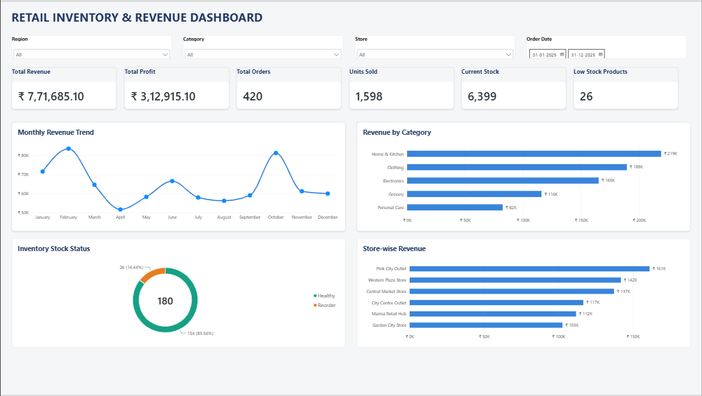

# Retail-Inventory-Revenue-Analytics
Retail sales, revenue, profitability and inventory analysis using Excel, MySQL and Power BI.
# 🛒 Retail Inventory & Revenue Analytics

### End-to-End Data Analytics Project | Excel • MySQL • Power BI

An end-to-end data analytics project focused on analyzing retail sales, revenue, profitability, product performance, store performance, and inventory health using Microsoft Excel, MySQL, and Power BI.

---

## 📊 Dashboard Preview



---

## 📌 Project Overview

This project analyzes a synthetic retail portfolio dataset covering January 2025 to December 2025.

It combines sales transactions, product information, store details, and inventory records to generate meaningful business insights and support data-driven decision-making.

## 🎯 Project Objectives

- Analyze overall sales and revenue performance.
- Identify top-performing products.
- Evaluate category-wise profitability.
- Compare revenue across retail stores.
- Identify products requiring inventory replenishment.
- Monitor inventory value and stock availability.
- Build an interactive Power BI dashboard.

## 🛠️ Tools & Technologies

| Tool | Purpose |
|---|---|
| Microsoft Excel | Data analysis and KPI calculations |
| MySQL 8.4 | Database management and SQL analysis |
| Power BI Desktop | Interactive dashboards and visualizations |
| GitHub | Project documentation and version control |

## 📁 Dataset Overview

| Dataset | Records |
|---|---:|
| Sales | 670 |
| Products | 30 |
| Stores | 6 |
| Inventory | 180 |
| **Total** | **886** |

**Reporting Period:** January 2025 – December 2025  
**Currency:** Indian Rupee (INR)

## 📈 Key Performance Indicators

| KPI | Result |
|---|---:|
| Total Net Revenue | ₹7,71,685.10 |
| Total Profit | ₹3,12,915.10 |
| Total Orders | 420 |
| Units Sold | 1,598 |
| Average Order Value | ₹1,837.35 |
| Profit Margin | 40.55% |
| Closing Stock Units | 6,399 |
| Closing Inventory Value | ₹21,94,689 |
| Low-Stock Combinations | 26 |

## 📊 Excel Analysis

- Product-wise revenue and profit analysis.
- Top 5 products by revenue.
- Category-wise performance.
- Monthly revenue trend.
- Inventory summary and stock monitoring.
- Revenue, cost and profit reconciliation.

## 🗄️ MySQL Analysis

Created a relational database named `retail_inventory` with four tables:

- Products
- Sales
- Stores
- Inventory

**SQL Concepts Used:**

- SELECT, WHERE and ORDER BY
- GROUP BY and Aggregate Functions
- INNER JOIN
- Subqueries
- Common Table Expressions (CTEs)
- Window Functions
- ROW_NUMBER()
- Inventory Analysis
- Data Quality Checks

## 📉 Power BI Dashboard

Developed an interactive dashboard featuring:

**Six KPI Cards**
- Total Revenue
- Total Profit
- Total Orders
- Units Sold
- Current Stock
- Low Stock Products

**Four Visualizations**
- Monthly Revenue Trend – Line Chart
- Revenue by Category – Bar Chart
- Inventory Stock Status – Doughnut Chart
- Store-wise Revenue – Bar Chart

**Interactive Filters**
- Region
- Category
- Store
- Order Date

## 💡 Key Business Insights

1. Generated ₹7.72 lakh in net revenue and ₹3.13 lakh in profit.
2. Achieved an overall profit margin of 40.55%.
3. Sold 1,598 units across 420 unique orders.
4. Home & Kitchen generated the highest category revenue.
5. Pink City Outlet recorded the highest store revenue.
6. 26 product-store combinations required stock replenishment.

## 📂 Project Structure

```text
Retail-Inventory-Revenue-Analytics/
│
├── Dataset/
│
├── SQL/
│   └── Retail_Inventory_Analysis.sql
│
├── Retail_Inventory_Revenue_Dashboard.pbix
│
├── Retail_Inventory_Revenue_Dashboard_Preview.png
│
└── README.md
```

## 🚀 Project Workflow

1. Dataset exploration using Excel.
2. KPI calculations and validation.
3. Database creation using MySQL.
4. CSV import and record validation.
5. SQL-based business analysis.
6. Data modeling and DAX measures.
7. Interactive Power BI dashboard development.

## 👨‍💻 Author

**Ujjwal Kumar**

B.Tech Computer Science Engineering Student  
Aspiring Data Analyst | BI Analyst

**GitHub:** [ujjwal-kumar12](https://github.com/ujjwal-kumar12)

---

⭐ If you find this project useful, feel free to explore the repository!
